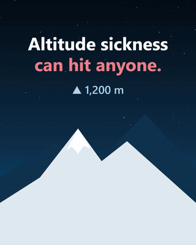
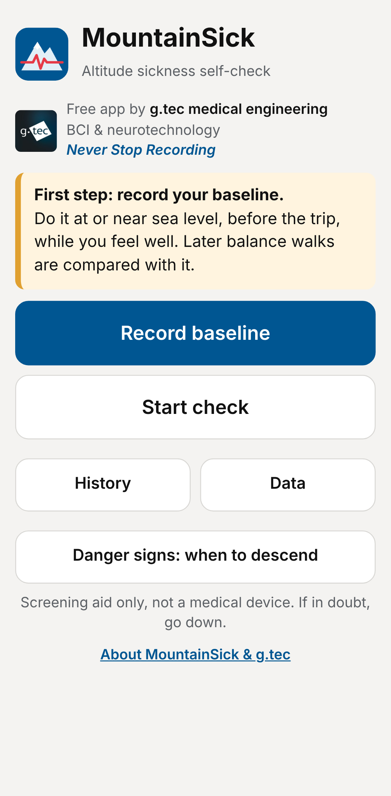
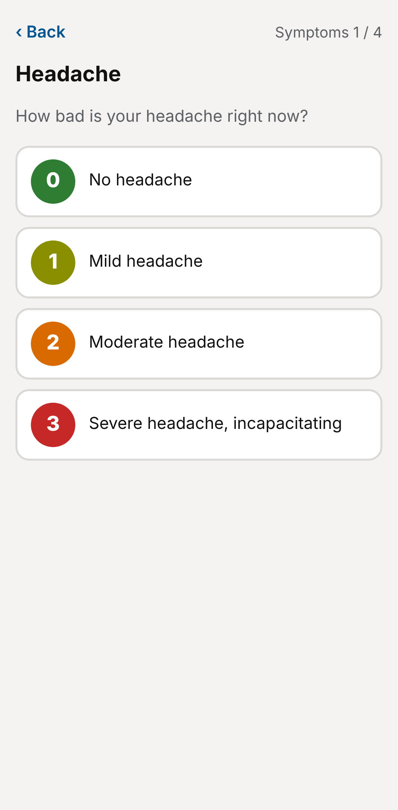
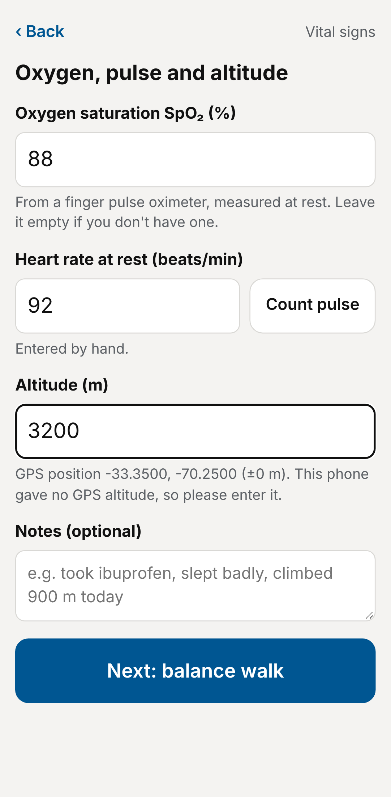
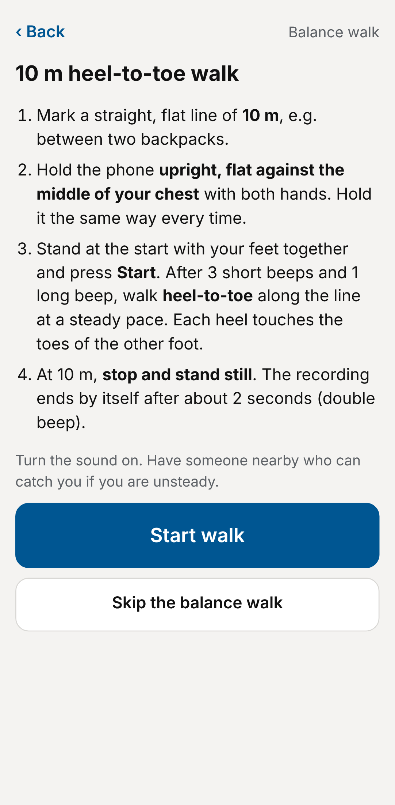
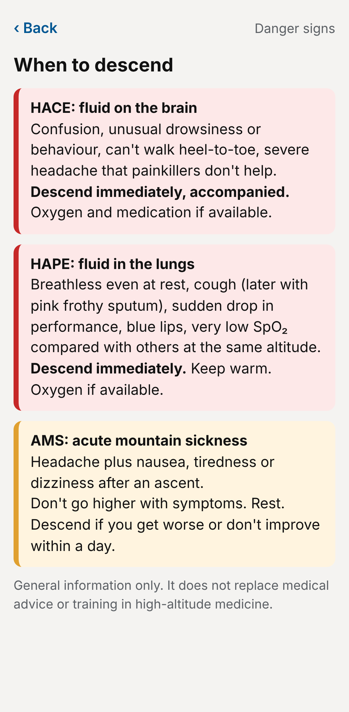
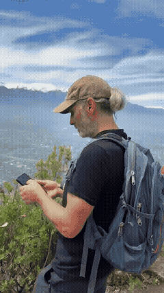

# MountainSick: altitude sickness self-check

-lightgrey)

**A free phone app from g.tec medical engineering that helps mountaineers and
trekkers spot acute mountain sickness (AMS) early.** It combines the Lake Louise
AMS Score, oxygen saturation and heart rate, GPS altitude, and a 10 m
heel-to-toe balance walk measured with the phone's motion sensors.

> **Screening and education aid only, not a medical device.** If in doubt, go down.

---

## Open the app

**[▶ Open MountainSick: mountainsick.netlify.app](https://mountainsick.netlify.app)**

1. Open the link in **Chrome** on your Android phone.
2. Menu (⋮) › **Add to Home screen / Install app**.
3. Open MountainSick once while you still have internet. After that it works
   **completely offline**. The *Data* screen shows "Offline ready: yes".

There is nothing to download from an app store and nothing to install on a PC.
All data stays on your phone and is never sent anywhere.

---

## What it measures

| | |
|---|---|
| **Lake Louise AMS Score (2018)** | Four symptoms (headache, stomach, tiredness, dizziness), each 0–3, answered with one tap. Plus the optional functional question and whether you recently climbed higher. Scoring follows Roach et al., *High Alt Med Biol* 2018. |
| **Vital signs** | SpO₂ and resting heart rate, typed in from a pulse oximeter. No oximeter? A hands-free **pulse counter** beeps a 30-second window while you count at your wrist. |
| **Altitude** | From GPS, which needs no internet. You can type it in if the phone gives no GPS altitude. |
| **Balance walk** | A 10 m heel-to-toe walk with the phone held against your chest. The accelerometer and gyroscope measure side-to-side sway, trunk wobble, step irregularity and walking time, and compare them with **your own sea-level baseline**. |
| **History** | Score and altitude over time, so you can follow your acclimatization day by day. Export as CSV, or as a full JSON backup with raw sensor data. |
| **Danger signs** | When to descend: HACE, HAPE and AMS warning signs. |

| Home | Lake Louise | Vital signs | Balance walk | Danger signs |
|---|---|---|---|---|
|  |  |  |  |  |

---

## How to use it

1. **Before the trip, at or near sea level:** tap *Record baseline* and do **2 walk trials**.
2. **At altitude:** tap *Start check*. Answer the questions, enter SpO₂ and heart
   rate, then do the walk (2 trials recommended).
3. Check *History* every day, ideally at the same time.

**Walk test tips:** hold the phone upright and flat against the middle of your
chest with both hands, the same way every time. Use flat ground and have someone
nearby who can catch you. Wait for 3 short beeps and 1 long beep, then walk
heel-to-toe. At 10 m, stand still: the test ends by itself.

---

## How the walk is analysed

- About 60 samples per second of acceleration and rotation.
- The walking part is found automatically: standing still before and after is removed.
- Gravity defines "up". The phone's x-axis, made horizontal, is "side-to-side". The remaining direction is "front-back".
- **Steps** are peaks in the smoothed vertical acceleration.
- **Step irregularity** is the coefficient of variation of the step times. Gaps longer than twice the median count as hesitations.
- **Side-to-side sway** is the RMS of the lateral acceleration.
- **Trunk wobble** is the RMS of the trunk's sideways tilt speed (gyroscope).
- **Balance change** is the average % change of sway, wobble, irregularity and
  walking time compared with the baseline. Stepping off the line 2–3 times also
  raises the rating.

The balance thresholds (20 % / 50 % change) are rules of thumb, not validated cut-offs.

---

## Tested in the field

Christoph Guger testing MountainSick in the mountains around Santiago de Chile
(October 2026), here during the 10 m balance walk. The Lake Louise Score, heart
rate, SpO₂ and the balance test are compared with the sea-level baseline.
[See the post on LinkedIn](https://www.linkedin.com/feed/update/urn:li:activity:7517598905136611328/).

---

## Go further: EEG at altitude

MountainSick looks at symptoms, oxygen and balance. To look at the brain itself,
g.tec's **[Altitude Assessment](https://github.com/gtec-neurotechnology/altitude-assessment)**
app records visual and auditory evoked potentials (VEP, AEP) and resting EEG at
each elevation with a Unicorn BCI Core-4 or Core-8. It is the approach g.tec uses
in its own mountain studies on Mount Kazbek and in Upper Mustang, Nepal.

- [LinkedIn: "Altitude sickness can hit anyone, so we built a free app to measure it"](https://www.linkedin.com/feed/update/urn:li:activity:7516356949144317952/) (Oct 2026)
- [Space, altitude and extreme environments](https://github.com/gtec-neurotechnology/g.tec-neurotechnology-knowledge/blob/main/domains/space-altitude-and-extreme-environments.md), g.tec knowledge base

---

## License

Free for private, personal, non-commercial use. All rights reserved by
g.tec medical engineering GmbH. See [LICENSE](LICENSE).

> **Not a medical device.** MountainSick is a screening and education aid. It does
> not diagnose, treat or prevent any disease or medical condition, and it does not
> replace medical advice or training in high-altitude medicine.

---

## Support

Questions about MountainSick or EEG at altitude: [www.gtec.at](https://www.gtec.at)

© 2026 g.tec medical engineering GmbH.
